# ☠️ JAKARIA6231 | CYBERSPACE

<div align="center">


[](https://git.io/typing-svg)

[](https://github.com/jakaria6231)
[](https://github.com/jakaria6231)


</div>

---

## `whoami`

```bash
┌──(jakaria㉿cyberspace)-[~]
└─$ whoami

Cybersecurity Enthusiast | Programmer
```

Hey there! I'm **Jakaria**, a passionate learner exploring the world of cybersecurity, ethical hacking, programming, and Linux.

I'm interested in understanding how systems work, identifying security weaknesses, and building useful software.

- 🔐 Exploring Cybersecurity & Ethical Hacking
- 🐧 Working with Linux and Kali Linux
- 💻 Learning Programming & Data Structures
- 🛡️ Interested in Network Security and Threat Detection
- 🚀 Building projects and improving my technical skills
- 🎯 Goal: Become a skilled Cybersecurity Professional

---

## `tech_stack`

<div align="center">

### Programming Languages


### Tools & Technologies


</div>

---

## `cybersecurity_interests`

```text
[01] Ethical Hacking
[02] Linux Administration
[03] Network Security
[04] Web Application Security
[05] Vulnerability Assessment
[06] Threat Detection
[07] Security Research
[08] Programming & Automation
```

---


## `github_statistics`

<div align="center">






</div>


---

## `featured_projects`

<div align="center">

[](https://github.com/jakaria6231/CyberShield)

</div>

---

## `current_mission`

```bash
[+] Mastering C++ and Java
[+] Practicing Data Structures & Algorithms
[+] Exploring Kali Linux
[+] Learning Cybersecurity Fundamentals
[+] Building Real-World Projects

STATUS: LEARNING IN PROGRESS...
```

---

## `connect_with_me`

<div align="center">

[](https://github.com/jakaria6231)

</div>

---

<div align="center">

### 「 THINK LIKE A HACKER. BUILD LIKE AN ENGINEER. 」

**ACCESS IS A PRIVILEGE. KNOWLEDGE IS POWER.**


</div>
